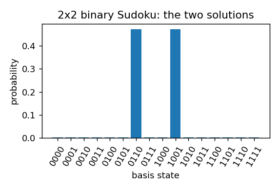
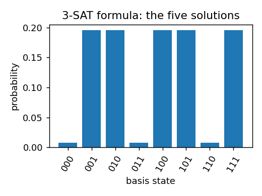

# Grover's algorithm for satisfiability problems

Grover's algorithm in PennyLane, applied to Boolean satisfiability. It solves
any formula written in CNF or DNF and generalized *n* × *n* Sudoku boards, and
looks at how the circuits behave under noise and zero-noise extrapolation.

<p align="center">
  
  
</p>

## How it works

Grover's algorithm finds the `M` solutions among `N = 2^n` states in about
`sqrt(N/M)` steps. Each step applies an *oracle*, which flips the sign of the
solutions, and a *diffuser*, which reflects the amplitudes about their average
and gradually moves the probability onto the solutions.

The oracles use phase kickback. Each clause or constraint is computed onto a
spare qubit, the results are combined onto an ancilla kept in the `|−⟩` state,
and the spares are then uncomputed. Any problem therefore only has to describe
its condition as reversible Boolean logic.

The usual iteration count, `k ≈ (π/4) sqrt(N/M)`, assumes solutions are rare.
When more than half the states are solutions it underestimates, and the
notebook shows how to choose `k` in that case.

A standard way around this, not implemented here, is to add one extra qubit
to the search space. That doubles `N` while `M` stays the same, so the
solutions become rarer in relative terms and Grover's algorithm can amplify
them to a high probability again.

## Sudoku

`solve_sudoku(n, values, box, givens)` builds the oracle for an `n` × `n` board
where each cell takes one of `values` symbols, with an optional sub-grid rule
`box` and pre-filled cells `givens`. Each cell uses `ceil(log2(values))` qubits,
and every row, column and box adds "these cells must differ" constraints.

The qubit count grows quickly. The binary 2 × 2 board needs 9 qubits and a
2 × 2 board with three symbols needs 19, so only small boards fit in a
simulator.

## Usage

```bash
pip install -e .                  # add ".[hardware]" for the IBM cells
```

```python
from grover_sat import solve_cnf, solve_sudoku, top_states, decode_board, board_grid

# (x0 or x1 or not x2) and (not x0 or not x1 or x2)
probs = solve_cnf([[1, 2, -3], [-1, -2, 3]], n_vars=3)
print(top_states(probs, 3))

probs = solve_sudoku(2, values=2)
for label, p in top_states(probs, 4):
    print(board_grid(decode_board(int(label, 2), 2, 2), 2), round(p, 3))
```

The full walkthrough, with the plots, is in
[`notebooks/grover_for_sat.ipynb`](notebooks/grover_for_sat.ipynb).

## Repository layout

```
grover_sat/     grover.py (diffuser, iteration count), sat.py, sudoku.py
notebooks/      the walkthrough
tests/          checks against brute force
docs/           the course report
```

## Credits

Quantum Computing course, MSc in Engineering Physics, University of Minho, with
materials from professors Luís Barbosa and André Sequeira. Built with
[PennyLane](https://pennylane.ai/). MIT License.
